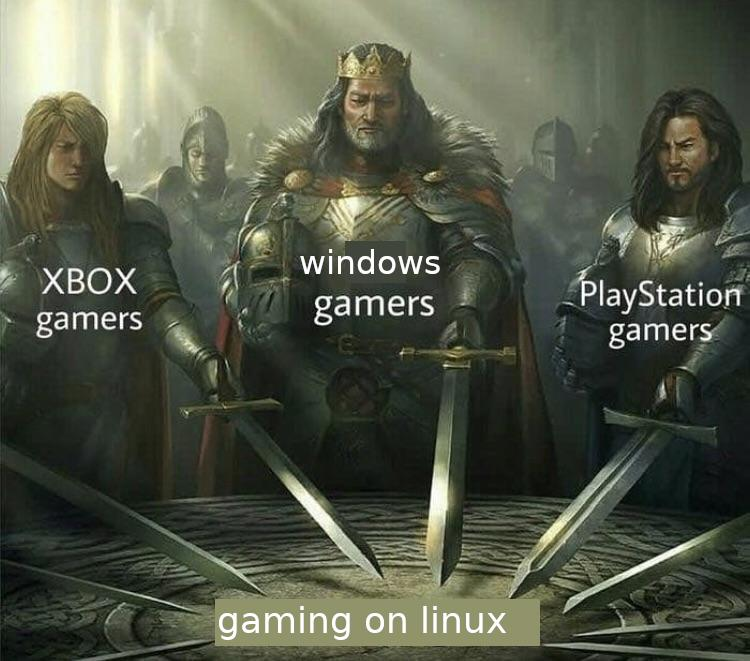

# 🎮 Gaming on Linux - Dokumentasi & Catatan Kompatibilitas

<p align="center">
  
</p>

Repositori ini berisi dokumentasi dan catatan konfigurasi untuk menjalankan game di Linux menggunakan Steam, Proton, Wine, dan berbagai tweak pendukung.

---

### 🖥️ Spesifikasi  Pengujian
- **Distro:** Zorin OS ( Ubuntu 24.04.5 )
- **Kernel:** Linux 7.0.0-42-generic
- **GPU & Driver:** Geforce GTX 1650 4 Gb (Driver : NVIDIA-SMI 580.178.04 )


---

## 📁 Struktur Repositori

```text
gamingonlinux/
├── README.md               # Panduan utama, cheatsheet, dan indeks game
├── TEMPLATE.md             # File template kosong siap salin untuk game baru
└── games/                  # Folder catatan kompatibilitas per game (1 file per game)
    ├── apex-legends.md

```

---

## 📑 Indeks Game Teruji

| Game | Status | Runner Rekomendasi | Tautan Dokumentasi |
| :--- | :---: | :--- | :--- |
| **Wuthering Waves** | 🟡 Gold | `DW-Proton Lastest` | [Lihat Catatan](games/wutheringwaves.md) |
| **Zenless Zone Zero** | 🟡 Gold | `DW-Proton Lastest` | [Lihat Catatan](games/zenlesszonezero.md) |
| **Roblox (Sober)** | 🟡 Gold | `-` | [Lihat Catatan](games/roblox.md) |

> *Catatan status:* 🟢 **Platinum** (Berjalan lancar tanpa hambatan) • 🟡 **Gold** (Perlu sedikit tweak sederhana) • 🟠 **Silver** (Dapat dimainkan namun ada bug kecil) • 🔴 **Borked** (Tidak dapat dimainkan).

---
